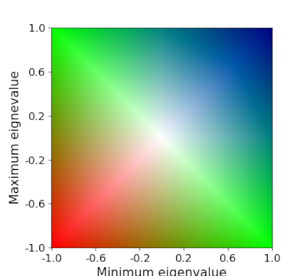

Structural Analysis
===================

Reminder:
    Do not forget to only work with the last timestep. One can extract it using the following awk command::

        awk '/^ITEM: TIMESTEP/ { block = $0 "\n"; next } { block = block $0 "\n" } END { printf "%s", block } ' FILENAME.lammpstrj > FILENAME_LAST_TIMESTEP.lammpstrj

Loading the relaxed helix
-------------------------

After extracting the last timestep, one can load it using the function :doc:`shanc.create_helix_from_file<../api/functions/create_helix_from_file>` or the method :doc:`Helix.read_structure<../api/methods/read_structure>`.
It is recommended to also load the starting helix as a lattice as it will provide all the mapping information easily.::

    import shanc
    import shanc.examples

    file_lattice = shanc.examples.SiO2_helix
    file_last_timestep = shanc.examples.SiO2_last_timestep

    pitch = 100.
    width = 30.
    thickness = 20.
    diameter = 60.
    turns = 1

    helix = shanc.Helix(pitch=pitch,width=width,thickness=thickness,diameter=diameter,turns=turns,file_lattice=file_lattice)
    helix.read_structure(file_last_timestep)

Quick Surface Reconstruction
----------------------------

To create surfaces of the helices, we used a `VMD-like <https://www.ks.uiuc.edu/Research/vmd/>`_ approach.
Following `Krone, Stone, Ertl and Schulten paper <https://diglib.eg.org/items/d34c2b92-60b4-489b-8801-9b8cad2d8ba2>`_, one computes first a pseudo-surface by creating large gaussians around each atom,

:math:`\rho(r) = \sum_i e^{-\frac{|r-r_i|^2}{2\alpha^2}}`

This pseudo surface is computed on a rectilinear grid with a spacing *d_spacing*, then an isovalue is collected and smoothing is done afterwards.

The parameters for each reconstruction, which can be modified with the sliders in SHAnC are:

    - **Spacing** : the distance between each point of the rectilinear grid. The lower, the more precise, but the longer calculation
    - **Alpha** : the alpha parameter of the surface reconstruction formula. The higher, the larger each sphere is
    - **Isovalue** : the value from which to compute the isovalue
    - **Smoothing** : How many passes of smoothing are done, the larger the smoother the surface will be, possibly at the cost of the defects of the surface

As one cannot use the whole grid to compute the surface as it is too costly, the system is divided in small cubes to do so.
The common parameters which have to be changed as a keyword of the function are:

    - **length_box** : the length of each box that divides the system
    - **prec** : the distance by which to include the atoms for the reconstruction
    - **d** : the distance by which each limits is enlarged to create the rectilinear grid

Density Analysis
----------------

Using the surface reconstruction, it is possible to compute the density near each point of this surface using the :doc:`helix.plot_density<../api/methods/plot_density>` method.

.. pyvista-plot::
    :include-source: true

    import shanc
    import shanc.examples

    file_lattice = shanc.examples.SiO2_helix
    file_last_timestep = shanc.examples.SiO2_last_timestep

    helix = shanc.Helix(file_lattice=file_lattice)
    helix.read_structure(file_last_timestep)

    helix.plot_density()

Curvature Analysis
------------------

It is also possible to get the curvature of the system, with red being concave, blue convex and green saddle.

The method :doc:`helix.plot_density<../api/methods/plot_curvature>` will produce the following analysis :

.. pyvista-plot::
    :include-source: true

    import shanc
    import shanc.examples

    file_lattice = shanc.examples.SiO2_helix
    file_last_timestep = shanc.examples.SiO2_last_timestep

    helix = shanc.Helix(file_lattice=file_lattice)
    helix.read_structure(file_last_timestep)

    helix.plot_curvature()
